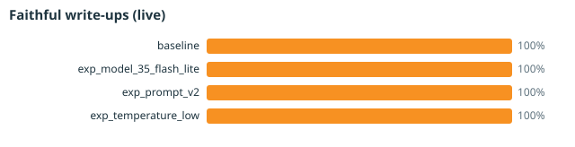
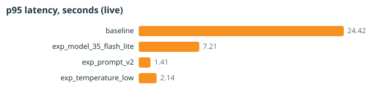

# Beacon evaluation & telemetry report

Generated 11/11/2026 01:18 PM EST by `python -m evals.run --all --replay`. Write-ups were replayed from saved live Gemini outputs (no new API calls).
Data fingerprint `5e895ab8ca2546a5` · reference ranking from app/src/domain.js via node · write-up mode: **LIVE Gemini**.

> Labels are rule-derived (see `evals/gold.py`); no human or expert labels exist yet. The shipped Beacon app has no
> generative AI — the Gemini write-up is an evaluation-only candidate feature.

## 1. Ranking experiments (vs. shipped reference top 10)

| Config | Factor | Shortlist | Overlap@10 | RBO@10 | Robust share of top 10 | Perturbation tests | Stability (mean top-10 Jaccard) | Stability p05 |
|---|---|---|---|---|---|---|---|---|
| baseline | reference | 68 | 100.0% | 1.00 | 60.0% | 8/8 | 0.33 | 0.18 |
| exp_ranking_composite | ranking | 68 | 80.0% | 0.87 | 60.0% | 7/7 | 0.33 | 0.18 |
| exp_ranking_conservative | ranking | 7 | 60.0% | 0.88 | 100.0% | 7/7 | 0.27 | 0.13 |
| exp_ranking_driving | ranking | 97 | 50.0% | 0.40 | 40.0% | 6/6 | 0.38 | 0.25 |

Reference top 10: Apopka (12095017703), Apopka (12095017600), Sanford (12117020901), Unincorporated Osceola (12097042902), Unincorporated Orange (12095017019), Unincorporated Orange (12095016406), Rosemont (12095012402), Union Park (12095016504), Florida Center (12095014812), Lockhart (12095015104).

*Robust share* = fraction of the top 10 whose poverty 90% lower bound still clears the cutoff. *Stability* = Jaccard overlap of the top 10 before/after redrawing every poverty and SNAP estimate inside its margin of error (baseline: fixed seed, see config).

## 2. Confidence-label calibration

Shortlist flip rate = share of Monte Carlo redraws in which a tract's shortlist membership changes. A useful label should give *High* the lowest flip rate.

| Config | Label counts (H/M/L) | High: n, flip rate | Medium: n, flip rate | Separation (Medium − High) | Rule re-derivation agreement |
|---|---|---|---|---|---|
| baseline | 43/445/2 | 25, 17.4% | 93, 17.9% | +0.5 pts | 100.0% |
| exp_confidence_margin_aware | 12/476/2 | 4, 1.7% | 114, 18.4% | +16.7 pts | n/a |

## 3. Write-up experiments — LIVE Gemini

| Config | Factor | Model | n (errors) | Faithful | Unsupported numbers | Wrong place | Confidence correct | Shaky-number questions | Same verdict on repeat | p50 / p95 latency (s) | Tokens in / out / thinking | Est. cost per run | Est. cost per faithful |
|---|---|---|---|---|---|---|---|---|---|---|---|---|---|
| baseline | reference | gemini-3.1-flash-lite | 20 (0) | 100.0% | 0.0% | 0.0% | 100.0% | 0.0% | 100.0% | 2.39 / 24.42 | 330 / 81 / n/a | $0.0041 | $0.00020 |
| exp_model_35_flash_lite | writeup.model | gemini-3.5-flash-lite | 20 (0) | 100.0% | 0.0% | 0.0% | 100.0% | 0.0% | 100.0% | 1.20 / 7.21 | 330 / 88 / n/a | $0.0064 | $0.00032 |
| exp_prompt_v2 | writeup.prompt_version | gemini-3.1-flash-lite | 20 (0) | 100.0% | 0.0% | 0.0% | 100.0% | 100.0% | 100.0% | 1.01 / 1.41 | 478 / 85 / n/a | $0.0049 | $0.00025 |
| exp_temperature_low | writeup.temperature | gemini-3.1-flash-lite | 20 (0) | 100.0% | 0.0% | 0.0% | 100.0% | 0.0% | 100.0% | 0.97 / 2.14 | 330 / 80 / n/a | $0.0041 | $0.00020 |

Costs are estimates from list prices in `evals/configs/pricing.yaml`. Retries: baseline 0, exp_model_35_flash_lite 0, exp_prompt_v2 0, exp_temperature_low 0.

## 4. Grader checks

* Seeded-error test: corrupted 263 copies of 80 write-ups the grader had passed; it caught **263/263**. wrong_place: 80/80. invented_stat: 80/80. wrong_number: 70/70. wrong_confidence: 33/33.
* Grader vs. hand grades: **pending** — fill `evals/hand_grading/to_grade.csv` (30 items). Mark human_faithful = yes only if every number and place matches facts_json, the evidence confidence label is stated correctly, and nothing is invented. Otherwise no.

## 5. Charts





## 6. Reproduce

```bash
pip install -r evals/requirements.txt
python -m evals.run --all          # offline, mock write-ups
python -m evals.run --all --live   # Gemini write-ups (GEMINI_API_KEY in env)
```
Per-call telemetry: `evals/runs/telemetry.jsonl` and `evals/runs/telemetry.sqlite` (git-ignored, regenerated each run).
